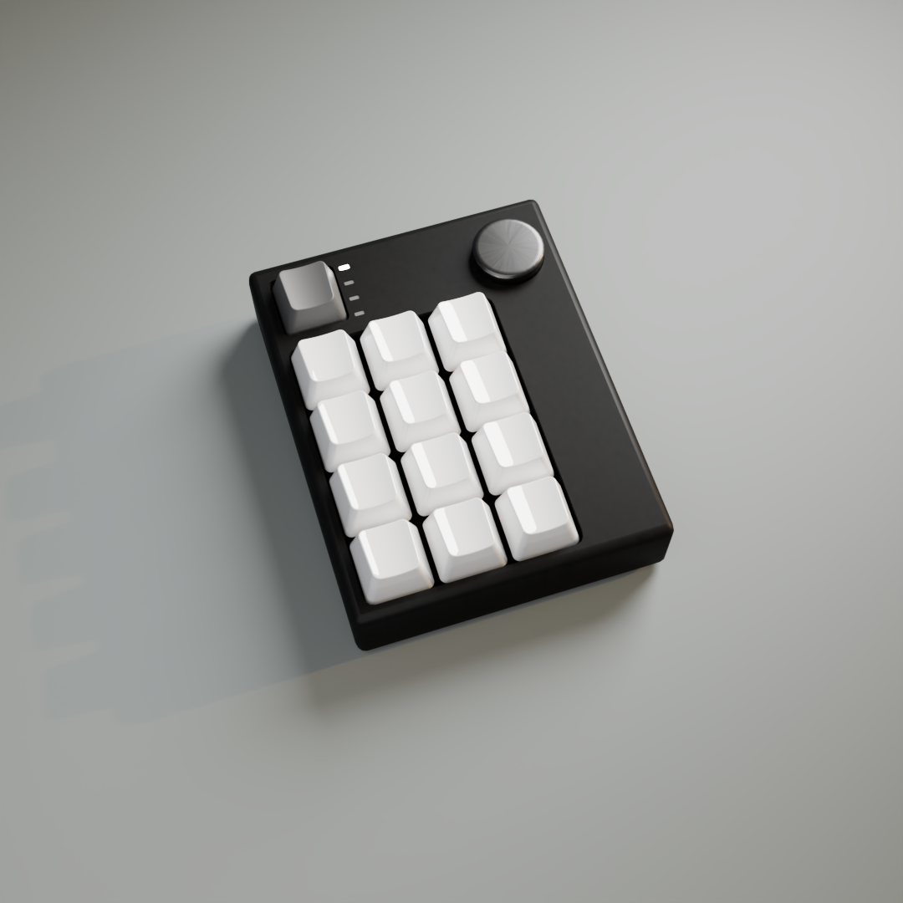
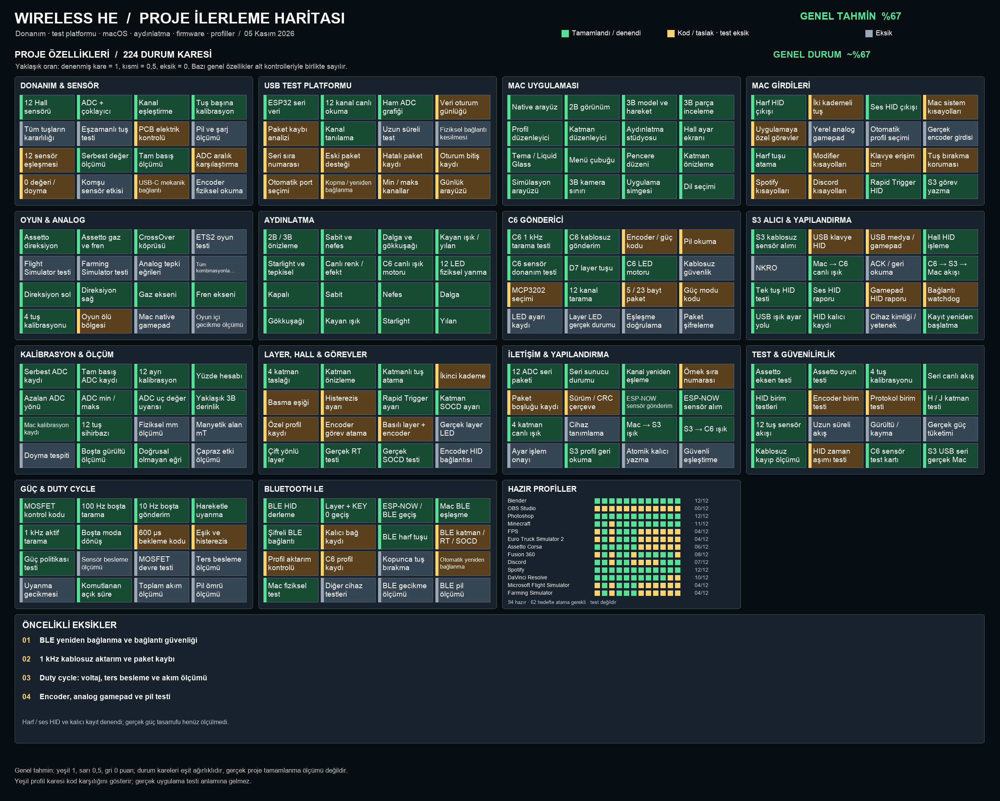
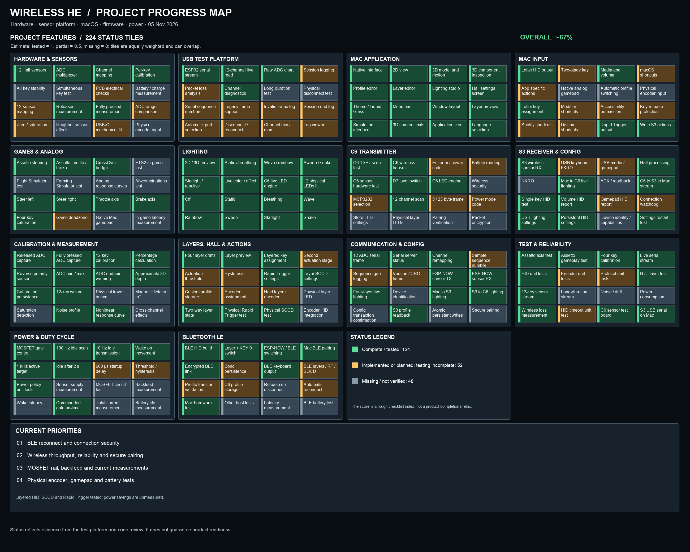

# Wireless HE Macropad - Bütünleşik Proje Rehberi

Güncelleme: 5 Kasım 2026. Bu belge, proje genelindeki tek başvuru rehberidir. Kullanıcı tarafından fiziksel olarak doğrulanan davranışlar, yazılmış fakat kapsamlı sınanmamış özellikler ve eksikler ayrı belirtilir. Çalışan prototip, nihai ürün değildir.



## 1. Proje ve kullanım amacı

Wireless HE, üç sütun ve dört satırdan oluşan 12 Hall efektli analog tuşlu, ayrı mekanik layer tuşlu ve encoder tasarımlı bir macropad prototipidir. Mıknatıs hareketini Hall sensörü ölçer; uygulama ve firmware bu değerden tuşun basılma oranını hesaplar. Tuşa özel eşik, katman, aydınlatma ve oyun uygulamalarında analog kullanım hedeflenir.

İki bağlantı yolu vardır. ESP-NOW modunda klavyedeki XIAO ESP32-C6 verileri kablosuz olarak ESP32-S3 dongle'a yollar; S3, bilgisayara USB HID ve seri telemetri sunar. BLE modunda C6 doğrudan bilgisayara Bluetooth klavye olarak bağlanır; S3 tuş iletimi için gerekmez. Bunlar halen test düzeneğindeki kodlardır; Firmware dizinindeki ayrı ürün taslaklarıyla karıştırılmamalıdır.

## 2. Şu an gerçekten doğrulananlar

| Alan | Doğrulanan davranış |
|---|---|
| Sensörler | 12 kanalın uygulamada görülmesi, 12 ayrı uç nokta kalibrasyonu, kalibrasyon sihirbazı ve Mac üzerinde kalıcılık kullanıcı tarafından doğrulandı. |
| ESP-NOW ve USB | C6'dan S3'e ve Mac'e sensör akışı; layer başına H/J yazdırma, kayıt sonrası S3 yeniden başlatma, uygulama kapalıyken HID ve ses azaltma örneği sınandı. |
| Hall davranışı | Seçilen bir tuşta Rapid Trigger ve iki tuşta son basılan öncelikli SOCD fiziksel olarak denendi; bütün ayar kombinasyonları test edilmedi. |
| BLE | C6 Mac'e eşleşti ve atanmış tuşla TextEdit'e yazdı. Layer + KEY 0 mod geçişi ve geçiş dalgaları kullanıcı tarafından görüldü. |
| Aydınlatma | 12 LED yandı; uygulama ile renkli dalga, sanal ve fiziksel tuş tetiklemesi ve layer senkronizasyonu belirli denemelerde eşleşti. BLE bağlantısız turuncu uyarı ve eşleştirme mavi efekti görüldü. |
| Güç politikası | Boşta 100 Hz tarama, aktif yaklaşık 1 kHz tarama ve yazılımın MOSFET komut süreleri gözlendi. Bunlar elektrik akımı veya pil ömrü ölçümü değildir. |
| Oyun ve hazır profil | Assetto Corsa analog direksiyon, gaz ve fren önceki kablolu test platformu ve CrossOver köprüsüyle denendi. Blender profilinde G, R ve S fiziksel olarak çalıştı. |

## 3. Fiziksel yerleşim ve eşleme

Tuş numaraları sütun sütun artar. KEY 0 sol üsttedir; layer düğmesi ve encoder 12 Hall tuşunun dışındadır.

```
KEY 0    KEY 4    KEY 8
KEY 1    KEY 5    KEY 9
KEY 2    KEY 6    KEY 10
KEY 3    KEY 7    KEY 11
```

Mevcut kartta varsayılan ham ADC eşlemesi bu mantıksal sırada 1, 3, 6, 9, 0, 4, 7, 10, 2, 5, 8, 11'dir. Mac uygulamasında kanal eşlemesi değiştirilebilir. C6 üzerindeki mod kısayolu ise mevcut kodda ADC 1'e sabittir; Mac'teki yeniden eşlemeden otomatik etkilenmez.

| Parça | Mevcut rol |
|---|---|
| DRV5055A4, 12 adet | Analog Hall sensörleri; mevcut mıknatıs yönünde basıldıkça ADC genellikle azalır. |
| CD74HC4067 | Analog 16 kanal çoklayıcı; 12 kanal kullanılır. |
| MCP3202 | 12 bit harici ADC; çoklayıcının COM çıkışı CH0'a gider. |
| XIAO ESP32-C6 | Sensör okuma, LED, layer, BLE ve ESP-NOW test firmware'i. |
| ESP32-S3 | ESP-NOW alıcısı, USB klavye/medya HID ve seri telemetri. |
| SK6812MINI, 12 adet | Adreslenebilir RGB zinciri. |
| AO3401A P-MOSFET | Test devresinde analog beslemenin aktif düşük kontrolü; elektriksel ölçüm bekleniyor. |

C6 test pinleri: çoklayıcı S0/S1/S2/S3 GPIO 0/1/2/21; ADC CS GPIO22, SCK GPIO19, MISO GPIO20, MOSI GPIO18; RGB GPIO16 (D6); analog besleme kapısı GPIO23 (D5); mekanik layer tuşu GPIO17 (D7), diğer bacağı GND. Bunlar mevcut test kablolamasıdır; farklı kartı bağlamadan önce şema ve gerçek bağlantılar kontrol edilmelidir.

## 4. Mod değiştirme ve Bluetooth

- Layer basılıyken KEY 0'a basılır; iki tuş bırakıldıktan ve geçiş dalgası tamamlandıktan sonra C6 yeniden başlar. Aynı kombinasyon BLE ve ESP-NOW arasında iki yönlü geçiş yapar.
- BLE'ye geçiş mavi, ESP-NOW'a geçiş yeşil iki dalga ile gösterilir. Kullanıcı geçiş efektini doğruladı.
- BLE'de Layer üç saniye tutulursa 60 saniyelik keşif penceresi açılır ve mavi onay efekti gösterilir. Beklerken başka Hall tuşuna basmak işlemi iptal eder. Layer + KEY 0 mod değiştirme için ayrılmıştır.
- BLE'de bağlı cihaz yokken normal ışık yerine tuşa basınca iki yumuşak turuncu uyarı gösterilir. ESP-NOW'da S3 görülmediğinde karşılık gelen uyarı kırmızıdır. BLE turuncu uyarı ve mavi eşleştirme efekti kullanıcı tarafından görüldü.
- Bağ anahtarlarını kalıcı saklama açıldı ve kullanıcı yeniden eşleşti. Güç kesme ve mod değişimi sonrasında otomatik yeniden bağlantı bu kayıtlarda henüz uçtan uca doğrulanmadı.
- BLE şifreleme ve Just Works bonding kullanır; Just Works araya giren saldırgana karşı kimlik doğrulaması sağlamaz. Çoklu cihaz ve yeniden eşleştirme politikası ayrıca sınanmalıdır.

## 5. Katmanlar, HID ve profil aktarımı

Studio'da dört layer düzenlenir. Desteklenen tuş, medya, Hall ve kalibrasyon kayıtları seçili layer için S3'e yazılabilir. S3 NVS saklaması ve bir katmanın yeniden başlatma sonrası korunması örnekle denendi. S3 tüm profilin anlık görüntüsünü ESP-NOW üzerinden parça parça C6'ya yayar; C6 eksiksiz çerçeve, CRC ve profil kontrolünden sonra NVS'ye kaydeder. BLE HID C6'daki bu yerel profili kullanır.

Profil yayını kaynak MAC kontrolüne ve CRC'ye dayanır; bunlar kimlik doğrulama veya saldırıya dayanıklı şifreleme değildir. İletim testi bir BLE tuş örneğini doğrular; tüm katmanlar, medya, iki kademe, RT, SOCD, kesinti sırasında tuş bırakma ve profil değişimlerinin tamamı BLE üzerinden henüz doğrulanmış değildir. USB ve BLE klavye raporu altı normal tuş kapasitelidir; NKRO değildir.

## 6. Studio uygulaması

SwiftUI, AppKit ve SceneKit tabanlı macOS uygulaması canlı ADC değerleri, grafik, kanal tanılama, kalibrasyon, yerel profil ve katman düzenleme, oyun seçenekleri ve aydınlatma önizlemesi sunar. 2B/3B model üzerinde tuş hareketi ve parça görünümü bulunur. Türkçe ve İngilizce seçenekleri vardır; bazı ekranlarda yerelleştirme eksikleri bulunabilir.

Studio uygulamasının yerel taslakları, S3'e yazılmış profil ve C6'ya kopyalanmış profil aynı şey değildir. Canlı aydınlatma ayarlarının cihazlar arasında aktarılması denendi; ışık ayarlarının bütün katmanlarda güç kesintisine dayanıklı olması genel olarak doğrulanmamıştır. Encoder donanımı, cihaz yapılandırmasına kaydetme ve çıkışı uçtan uca tamamlanmış kabul edilmemelidir.

Hazır profiller başlangıç noktasıdır. Etiketin HID karşılığı bulunması hedef programda aynı kısayolun etkin olduğunu göstermez; OBS ve diğer programlarda özel tuş ataması gerekebilir. Blender'da yalnızca kullanıcının denediği taşı, döndür ve ölçekle örnekleri doğrulandı.

## 7. Hız, güç ve duty cycle

ESP-NOW test politikasında hedef boşta 100 Hz sensör taraması, Studio kapalıyken yaklaşık 10 Hz, açıkken yaklaşık 100 Hz radyo gönderimi; hareket algılanınca 1 kHz tarama ve gönderim hedefidir. Radyo gönderim başvurusu, S3'ün alması ve USB giriş gecikmesi birbirinden farklı ölçümlerdir. Geçmiş kısa bir testte yaklaşık 983 tarama/s ve 858 gönderim başvurusu/s görüldü; 1 kHz uçtan uca garanti değildir.

Testte boşta MOSFET kapısı komut süresi yaklaşık yüzde 13 olarak gözlendi. 600 mikrosaniyelik sensör açılış beklemesiyle aktif modda duty cycle denemesi taramayı yaklaşık 620 Hz'e düşürdüğünden geri alındı; aktif modda analog besleme açık tutulur. MOSFET kontrol komutu, gerçek ray gerilimi, ters besleme, toplam akım, pil ömrü veya tasarruf yüzdesi ölçümü değildir. Bunlar ayrıca multimetre/osiloskop ve akım ölçümü gerektirir.

## 8. Işık ve bağlantı davranışları

Firmware ve önizlemede sabit, nefes, dalga, gökkuşağı, kayan ışık, tepkisel, basılan yerden dalga, starlight ve yılan gibi efektler bulunur. Bazı efekt ve renkler fiziksel cihazla test edildi; tüm parametreler ve uzun süreli çalışma henüz test edilmedi. Bağlantı ve mod geçiş işaretleri normal aydınlatmayı geçici olarak bastırır.

## 9. Öncelikli eksikler ve riskler

- BLE eşleşmesinin güç kesme, ESP-NOW'a geçiş ve geri dönüşten sonra otomatik yenilenmesini doğrula; bağlantı kopunca tüm tuşların bırakıldığını ve farklı bilgisayarları test et.
- ESP-NOW kaynak kimliğini güvenli doğrulama, şifreleme ve gerçek cihaz eşleştirmesi; sensör verisinde kayıp ve gecikme ölçümü.
- Gerçek MOSFET ray gerilimi, sensör yerleşmesi, geri besleme, akım ve pil ömrü ölçümü.
- Encoder ve layer göstergelerinin fiziksel bağlantı ve HID testleri; S3 üzerinde yerel analog gamepad ve NKRO.
- Tüm hazır profillerin hedef uygulamalarda tek tek denenmesi; erişilebilirlik, uzun süre ve hata sonrası toparlanma testleri.
- Tam montaj, plate üretimi, fiziksel toleranslar ve uzun süreli sensör kararlılığı.

## 10. Dizinler ve sürüm seçimi

| Yol | İçerik |
|---|---|
| Readme.md | GitHub için İngilizce proje tanıtımı ve güncel özet. |
| Docs/Proje_Rehberi.md ve output/pdf/Wireless_HE_Proje_Rehberi.pdf | Bu bütünleşik rehberin kaynak ve PDF sürümleri. |
| examples/c6_s3_sensor_bridge/c6 | Mevcut C6 sensör, ESP-NOW, BLE ve ışık test firmware'i. |
| examples/c6_s3_sensor_bridge/s3_composite | S3 USB HID ve seri telemetri test firmware'i. |
| examples/macropad_12_idf/mac_app | macOS uygulaması. |
| Firmware/ | Ayrı hedef ürün mimarisi ve firmware taslakları. |
| Hardware/ ve Docs/images/ | Şematik, PCB, model ve proje görselleri. |
| examples/c6_ble_hid_lab | Bağımsız eski BLE laboratuvarı; güncel bütünleşik sistem değildir. |
| examples/crossover_analog | Önceki CrossOver analog test köprüsü. |
| tools/progress.py ve tools/progress_english.py | Türkçe ve İngilizce durum görsellerinin kaynakları. |
| backups/ble-test | Önceki kart içeriklerinin yerel yedekleri; özel eşleşme ve cihaz bilgileri içerebilir, yayımlanmaz. |

Ayrıntılı geliştirme ve devir yönergeleri Docs/DEVIR.md dosyasındadır.

## 11. Derleme, yükleme ve korunacaklar

ESP-IDF 6.1 ortamında C6 projesi examples/c6_s3_sensor_bridge/c6, S3 projesi examples/c6_s3_sensor_bridge/s3_composite altındadır. C6'nın mevcut BLE ve güç seçeneklerini içeren yapılandırması sdkconfig.ble, derleme dizini build-ble'dir. S3 kendi build dizinini kullanır. Firmware yüklemeden önce kart kimliği, port, kablolama ve tüm Hall tuşlarının serbest olması doğrulanmalı; mevcut kalibrasyon ve profil kayıtları korunmalıdır.

BLE derlemesi daha büyük uygulama bölümü kullanır. Bölüm tablosu veya tam flash yazımı kullanıcı kayıtlarına zarar verebileceğinden önce yedek ve adres karşılaştırması yapılmalıdır. Basit derleme veya birim test, fiziksel doğrulamanın yerine geçmez.

## 12. İlerleme tabloları nasıl okunur

Docs/progress dizininde Türkçe ve İngilizce ayrıntılı haritalar ile karelerin açıklama listeleri bulunur. Yeşil belirli uygulama veya denemeyi, sarı eksik doğrulama ya da kısmi işi, gri eksikliği gösterir. Genel yüzde eşit ağırlıklı bir kontrol listesi tahminidir; iş yükü, kararlılık veya ürünün gerçek tamamlanma yüzdesi olarak yorumlanmamalıdır. Hazır profil kareleri kod karşılığını gösterir; hedef program testi değildir.

## 13. Türkçe ilerleme haritası



## 14. English progress map



Karelerin ayrıntılı ve okunabilir listeleri ayrı yüksek çözünürlüklü görsellerde korunur: Docs/progress/proje-durumu-kareler.png ve Docs/progress/project-progress-grid-en.png.

## 15. Geliştirici için devir ayrıntıları


Son doğrulama: 5 Kasım 2026. Ürüne ve güncel test sonuçlarına genel bakış için
[Proje_Rehberi.md](Proje_Rehberi.md); bağımsız sürümler için
[releases/CHANGELOG.md](../releases/CHANGELOG.md). Bu belge çalışmaya tam
olarak devam etmek isteyen kişi içindir. Kod ve gerçek cihaz durumu her zaman
son doğruluk kaynağıdır.

## Korunacak mevcut sistem

- Test kartı XIAO ESP32-C6 ve ESP32-S3 dongle. Kullanıcı BLE ile Mac'e yazmayı,
  Layer + KEY 0 ile mod geçişini, geçiş ışığını ve BLE bağlantısız turuncu
  uyarıyı denedi. RGB yumuşatma sonrasında turuncu efekt beğenildi.
- C6 ve S3'e bu depodaki `examples/c6_s3_sensor_bridge` projelerinden yazılım
  yüklendi. Kartın içeriği sonradan değişmiş olabilir; USB kimliği, bağlantı
  ve çalışan sürümü kontrol etmeden varsaymayın.
- C6 `sdkconfig.ble`: IDF 6.1, ESP32-C6, BLE NimBLE, NVS bonding, 8192 byte
  ana görev yığını, large single-app bölümü, MOSFET GPIO23, boşta duty cycle,
  600 µs bekleme, wake/release 60/30. `build-ble` üretilen dosyadır, kaynak
  değildir. S3 composite ESP-IDF projesi USB HID + seri arayüzdür. Son C6 fiziksel yüklemesi `examples/c6_s3_sensor_bridge/build-ble` dizininden yapılmıştır; C6 klasörü içinden derleme yapınca `c6/build-ble` oluşur.
- Bluetooth bonding için NVS kalıcılığı açıldı ve kullanıcı tekrar eşleşti.
  Güç kesme, tekrar açma ve ESP-NOW'a geçip dönme sonrası otomatik bağlanma
  **henüz kanıtlanmadı**. Önce bunu dene; kullanıcının Mac'indeki eşleşmeyi
  sebepsiz silme. BLE Just Works MITM doğrulaması sağlamaz.
- ESP-NOW paketleri şifresiz broadcast'tir. S3 profil yayınındaki CRC ve MAC
  kontrolü kimlik doğrulama değildir. Uçtan uca güvenli cihaz eşleşmesi eksik.
- `backups/ble-test/` yerel flaş yedekleri bonding anahtarı ve kişisel cihaz
  bilgileri içerebilir. Git'e ekleme; paylaşma. Tam yedeği körlemesine geri
  yazmak güncel kullanıcı kayıtlarını siler. Önce mevcut durumu yedekle.

## Kaynak haritası

| İş | Dosyalar |
|---|---|
| C6 okuma, güç, layer, LED, radyo | `examples/c6_s3_sensor_bridge/c6/main/main.c` |
| C6 BLE, keşif, pairing, HID | `examples/c6_s3_sensor_bridge/c6/main/ble_transport.c` |
| Tuş kombinasyonu, paketler, güç | `examples/c6_s3_sensor_bridge/shared/` |
| S3 profil, telemetri, HID | `examples/c6_s3_sensor_bridge/s3_composite/main/main.c`, `hid_engine.c`, `hid_profile.c`, `usb_composite.*` |
| RGB motoru | `examples/lighting_espnow_lab/components/lighting_core/` |
| Mac uygulaması | `examples/macropad_12_idf/mac_app/Native.swift`, `Model3D.swift`, `build_app.sh` |
| Mac seri köprüsü | `examples/macropad_12_idf/server.py` |
| Durum görselleri | `tools/progress.py`, `tools/progress_grid.py`, `tools/progress_english.py` |

Layer verisi S3 NVS'de saklanır ve parçalarla C6'ya aktarılır; cihaz profili,
Mac yerel taslakları ve aydınlatmanın canlı durumu ayrı kavramlardır. BLE C6
üzerindeki profil kopyasını kullanır. Mod tuşu C6 kodunda fiziksel ADC 1'e
sabitlenmiştir; uygulama kanal eşlemesiyle otomatik değişmez.

## Derleme ve test

C6 derlemesinden önce `source ~/.espressif/v6.1/esp-idf/export.sh`, ardından
`cd examples/c6_s3_sensor_bridge/c6` ve
`idf.py -B build-ble -D SDKCONFIG=sdkconfig.ble build`. S3 için
`cd examples/c6_s3_sensor_bridge/s3_composite` ve `idf.py build`.
Kartların portunu ve yedeğini kontrol etmeden `flash` çalıştırma. `idf.py`
bölüm tablosunu da yazabilir; NVS ve flash adreslerini önce karşılaştır.

S3/C6 ortak C testleri `examples/c6_s3_sensor_bridge/tests/` altındadır;
`test_transport_mode.c`, `test_ble_hid_report.c`,
`test_ble_profile_staging.c`, `test_ble_profile_wire.c` ve
`test_ble_profile_integration.c` bağımsız host C testleridir. HID engine ve
profile kaynaklarıyla derlenir. Build ve unit test donanım davranışını kanıtlamaz.

Studio `examples/macropad_12_idf/mac_app/build_app.sh` ile yerelde derlenir.
Bu script uygulamayı silip yeniden oluşturur ve Info.plist'e yerel Python ile
proje yollarını yazar. Bu nedenle üretilen uygulama başka Mac'e otomatik
kurulabilir sayılmaz. Kullanıcının açık uygulamasını kapatmadan veya yerel
verilerini silmeden çalış; ayarlar ve kullanıcı profillerini koru.

## Öncelikli sonraki testler

1. Tüm tuşlar serbestken C6'yı yeniden başlat. Mevcut BLE eşleşmesi korunuyor
   mu ve kullanıcı cihazı unutmadan otomatik geri bağlanıyor mu?
2. ESP-NOW'a geç, USB HID'i doğrula; BLE'ye dön, yeniden eşleşme istemeden
   klavye çıktısını kontrol et. Mod geçişi ve LED renklerini izle.
3. BLE bağlantısı kesilirken basılı tuş takılı kalıyor mu? Layer, medya,
   RT ve SOCD davranışlarını BLE'de ayrı ayrı doğrula.
4. 3 saniyelik keşif modunun diğer tuşa basınca iptalini, pencere süresini ve
   ikinci bir cihazda davranışını kontrol et. Keşif görünürlüğü kısıtlaması
   tek başına güvenli kimlik doğrulama değildir.
5. ADC gürültüsü, güç rail yerleşmesi, MOSFET ters beslemesi ve gerçek akımı
   ölç; yazılım duty oranını pil ömrü olarak sunma.

## Sürümleme

Üç bağımsız bileşenin sürümleri `releases/versions.json`, geçmişi
`releases/CHANGELOG.md` dosyasındadır. Git commit'leri eski kodu korur;
GitHub ön sürümleri `c6/vX.Y.Z`, `s3/vX.Y.Z` ve `studio/vX.Y.Z` etiketlerini
kullanır. Kod değişikliğinde ilgili bileşenin sürümünü artır, değişikliği ve
kanıtını not et, test et ve yeni commit ile yayınla. Yayımlanmış etiketi veya
release'i değiştirme. Başlangıç 0.1.0 ürünün bitmiş olduğunu göstermez.
