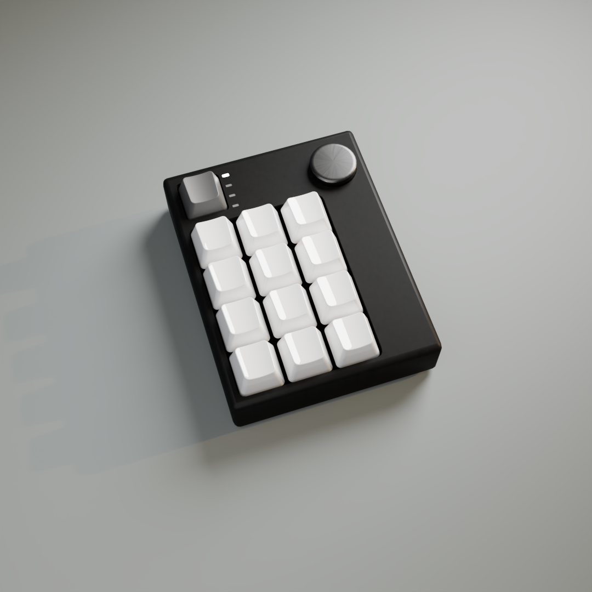
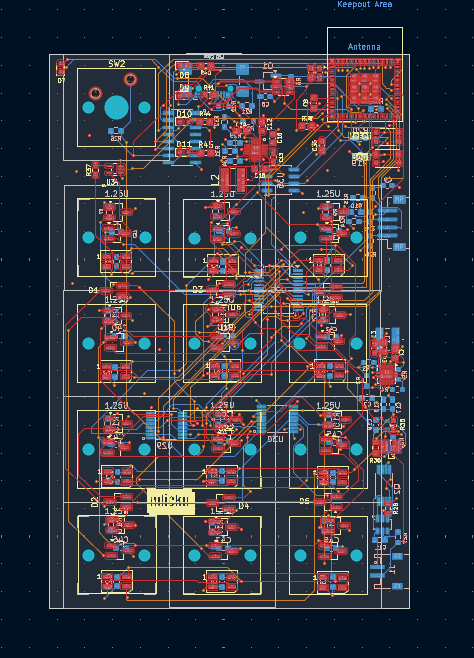
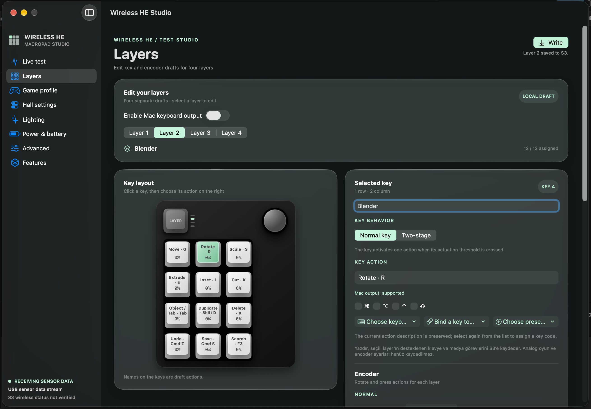
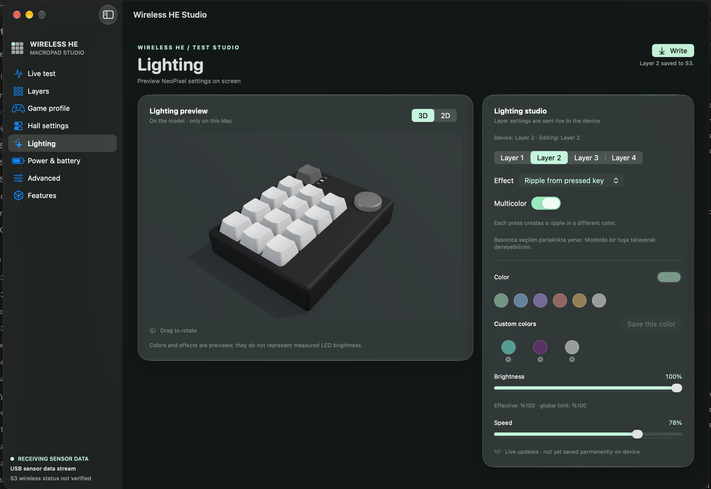
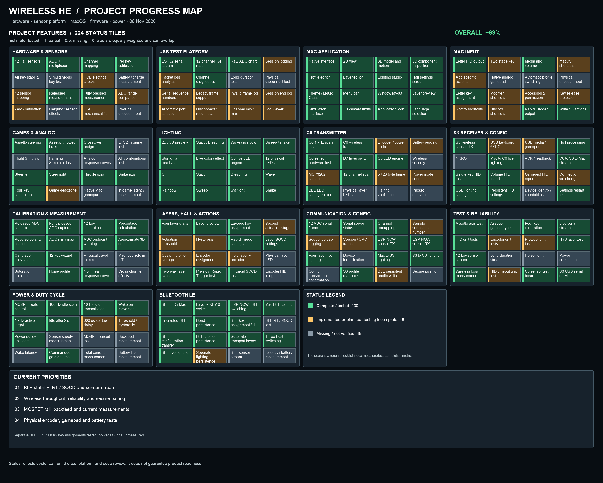

> **Separate transport profiles (experimental):** C6 0.1.6 and Studio 0.1.4 keep BLE and ESP-NOW layer settings separately, copying prior shared settings on first migration. Separate key assignments across mode switches were verified on the current hardware. Hall calibration remains shared.

> **6 November 2026:** Studio supports configuring C6 lighting, selecting layers and writing supported per-layer HID assignments over encrypted BLE. Hardware checks confirmed lighting changes on two layers and an H assignment that survived a C6 restart. Three paired-slot names are locally editable aliases, not automatically retrieved host names. BLE sensor telemetry and automatic synchronization between C6 and S3 are not implemented; a solid lighting color also persisted across a restart with Studio closed. Other hosts need further testing.

# Wireless HE Macropad

A wireless, 12-key Hall-effect macropad built around a custom PCB, an ESP32-C6 sender, an ESP32-S3 USB receiver, and a native macOS companion app.

The project explores analog key travel, configurable actuation, per-layer actions, responsive lighting, and power-conscious wireless operation. It is an **active hardware and firmware prototype**, not a finished commercial product.

[](https://github.com/espressif/esp-idf)
[](#wireless-he-studio)
[](#what-works-today)
[](LICENSE)

## At a glance

- **12 analog Hall-effect keys**, arranged in three columns and four rows.
- A separate mechanical **layer button**, four layer indicator positions, and a rotary encoder in the design.
- **ESP32-C6 → ESP-NOW → ESP32-S3 → USB** for the current wireless test system.
- Direct **C6-to-host BLE HID** is integrated and keyboard output was confirmed on a Mac. Bond persistence and automatic reconnection still need a complete restart and mode-switch test.
- A custom PCB with DRV5055 sensors, a 16-channel multiplexer, and an external 12-bit ADC.
- Per-key lighting driven by a chain of 12 addressable LEDs.
- **Wireless HE Studio**, a native macOS app with live telemetry, calibration, interactive 2D/3D views, layers, and lighting controls.

## Gallery

<table>
<tr>
<td align="center"><br><b>Enclosure and layout</b></td>
<td align="center"><br><b>Custom PCB</b></td>
</tr>
<tr>
<td align="center"><br><b>Studio · layers and key assignments</b></td>
<td align="center"><br><b>Studio · lighting and 3D preview</b></td>
</tr>
</table>

The enclosure and PCB images are renders; Studio screenshots illustrate the interface and may not show its latest revision.

## How it works

Each key moves a magnet past a Hall sensor. The sensor's analog output is sampled and converted into a calibrated position, allowing the prototype to react to key travel rather than just an on/off switch.

```text
12 × DRV5055 sensors → CD74HC4067 multiplexer → MCP3202 ADC
                                                    │
                                           ESP32-C6 macropad
                                                    │ ESP-NOW
                                                    ▼
Mac / computer ← USB HID + serial telemetry ← ESP32-S3 dongle
        │                                           ▲
        └──── Studio configuration and live lighting ┘
```

The repository contains both the **current C6/S3 test bridge** and separate, evolving product-firmware projects. They are not interchangeable builds and do not necessarily use the same pin assignments.

## What works today

The following describes the test setup and the specific behavior observed, as of **5 November 2026**. A successful test of one action does not mean every combination has been validated.

| Area | Observed on the prototype | Still to do |
|---|---|---|
| Sensing | All 12 channels appeared in Studio; individual calibration, channel mapping, and live key movement were checked. | Long-run stability, cross-channel effects, physical travel measurement, and full calibration validation. |
| Wireless link | C6 → S3 → Mac telemetry works; Studio displays scan, submission, reception, and sequence-gap counters. | Reduce active-mode gaps, measure latency and range, and add authenticated pairing/encryption. |
| Direct BLE | C6 paired with a Mac and typed using a saved profile; Layer + KEY 0 switched transport and the transition effects were checked. | Validate persisted bonding across reboot and transport changes, BLE disconnect release, other hosts, latency, and power. |
| USB keyboard | Layer-specific keyboard actions and volume-down HID were tested on a Mac. A saved layer survived an S3 reconnect; output also worked with Studio closed. | More host/shortcut tests, disconnect recovery, and NKRO. The current keyboard report is 6KRO. |
| Hall behaviors | Rapid Trigger retriggering was tested with a partially released key. SOCD's last-pressed priority and return to the held key were also tested. | Wider sensitivity, multi-key, and long-duration hardware tests; two-stage behavior needs a physical test. |
| Lighting | All 12 LEDs lit. Live layer/effect synchronization, rainbow or snake color behavior, and virtual-key ripple triggering were checked. Sweep turn-off and ripple stopping were also checked physically. | Validate the complete effect set and persistence; lighting configuration is currently sent live rather than stored permanently on the device. |
| Power policy | Idle sensor scans and software-controlled MOSFET duty cycling were observed; the app displays commanded gate on-time. | Measure rail voltage, startup/settling, backfeed, actual current, and battery life. |
| Mac app | Live sensor values, 2D/3D views, layer controls, local profiles, and the device write path are available. Blender's move, rotate, and scale actions were tested. | Complete and validate all target-app actions, accessibility, long-term performance, and hardware integration. |
| Mechanical | A 3D model, PCB design, and enclosure renders exist. | Manufacture and validate the plate, case fit, and final assembly. |



The percentage in the graphic is a **manually reviewed, equally weighted checklist estimate**. Some items overlap; it is not a measurement of remaining work, reliability, or product readiness. See the [compact progress grid](Docs/progress/project-progress-grid-en.png) for the item index.

## Wireless HE Studio

Studio is a native **SwiftUI / AppKit / SceneKit** macOS application. Its current features include:

- A live ADC graph, raw channel diagnostics, channel remapping, per-key calibration, and idle-noise measurements.
- Interactive 2D and 3D views, key motion, and an exploded component view based on the project model.
- Four layers with keyboard/media actions, traditional thresholds, Rapid Trigger, SOCD, and local profile storage.
- Lighting previews and live control of effects such as static, breathing, wave, sweep, reactive, ripple, starlight, rainbow, and snake.
- Live rate and power-policy telemetry, including **commanded GPIO on-time** rather than a measured power figure.
- Turkish and English interface options, local backup, and sensor-session logs.

Studio includes 13 starter profiles covering creative applications and games. The 156 preset entries include direct mappings and suggested shortcuts that may need assignment in the target application; mapping and real application validation are distinct. The UI identifies these assignments. A mapped output does not prove the target application accepts it or that its shortcuts match the user's settings. Encoder actions and native analog gamepad output are not yet implemented end to end.

Studio writes supported actions for the **selected layer** to the S3. Calibration endpoints and supported Hall settings are included; local profile storage and device storage are distinct. Verify the target layer and assigned shortcuts before writing.

## Sampling and power experiments

The current test policy scans at **100 Hz while idle**, with a **1 kHz active target** after detected movement. Idle radio updates are targeted at 10 Hz without Studio or 100 Hz while Studio is connected; active transmission targets 1 kHz. The observed values in Studio are measurements, not guarantees of those targets.

In one active test the C6 reported roughly **983 scans/s** and **858 radio submissions/s**. These are short observations under specific conditions; submissions, received packets, and end-to-end input latency are different measurements. Sequence gaps can arise in scheduling, radio transmission, buffering, or USB.

With the experimental MOSFET build, the idle test showed approximately **13% commanded gate on-time**. Active-mode duty cycling with a 600 µs startup wait reduced a trial to about **620 scans/s**, so that experiment was reverted: the current active mode keeps the analog rail commanded on. GPIO timing does **not** establish the actual rail voltage, energy savings, or battery life. No power-saving multiplier is claimed.

## Hardware overview

| Component | Role |
|---|---|
| 12 × DRV5055A4 | Analog Hall sensors |
| CD74HC4067 | 16-channel analog multiplexer |
| MCP3202 | 12-bit external ADC |
| XIAO ESP32-C6 | Current wireless sender test board |
| ESP32-S3 | USB receiver and HID test board |
| 12 × SK6812MINI | Addressable key lighting |
| Mechanical switch | Layer button; current test wiring uses D7 to GND |
| Rotary encoder and four indicators | Designed controls; full hardware integration remains in progress |

The **test-bridge** C6 wiring uses D0–D3 for multiplexer selection, D4 for ADC chip select, D8–D10 for SPI, D6/GPIO16 for LED data, D5/GPIO23 for the optional active-low analog power gate, and D7/GPIO17 for the layer button. Check the [bridge documentation](examples/c6_s3_sensor_bridge/README.md), the actual board, and the schematic before connecting or powering anything. These pins are **not** a promise about the separate product firmware.

## Repository layout

| Path | Contents |
|---|---|
| [`Hardware/Kicad/`](Hardware/Kicad/) | PCB and schematic source files |
| [`Firmware/macropad-sender/`](Firmware/macropad-sender/) | Developing C6 product firmware |
| [`Firmware/dongle-receiver/`](Firmware/dongle-receiver/) | Developing S3 product firmware |
| [`Firmware/shared/`](Firmware/shared/) | Shared firmware modules and tests |
| [`examples/c6_s3_sensor_bridge/`](examples/c6_s3_sensor_bridge/) | Current C6/S3 wireless prototype and HID bridge |
| [`examples/c6_ble_hid_lab/`](examples/c6_ble_hid_lab/) | Isolated, buildable BLE HID transport experiment (separate from the integrated C6 build) |
| [`examples/macropad_12_idf/mac_app/`](examples/macropad_12_idf/mac_app/) | Wireless HE Studio macOS app |
| [`examples/lighting_espnow_lab/`](examples/lighting_espnow_lab/) | Lighting engine and protocol experiments |
| [`examples/crossover_analog/`](examples/crossover_analog/) | Earlier CrossOver analog-controller experiment |
| [`tools/progress.py`](tools/progress.py) | Generates the Turkish project progress map |

The earlier Assetto Corsa steering/throttle/brake experiment used a **wired sensor platform and a CrossOver virtual-controller bridge**. It does not demonstrate native analog gamepad output from the current S3 dongle.

## Build and test

The prototype firmware has been built with the project's **ESP-IDF 6.1** environment. The following examples build only; select the correct board, port, wiring, and configuration before flashing.

```sh
# C6 BLE + ESP-NOW test configuration
cd examples/c6_s3_sensor_bridge/c6
idf.py -B build-ble -D SDKCONFIG=sdkconfig.ble build
```

```sh
# S3 composite receiver — run from the repository root
cd examples/c6_s3_sensor_bridge/s3_composite
idf.py set-target esp32s3
idf.py build
```

The **experimental MOSFET build** uses a separate power configuration and requires the correct physical switching circuit; see the [bridge README](examples/c6_s3_sensor_bridge/README.md) before using it. The standard build should not be assumed to have the same gate configuration as the test board.

For the macOS app, see the [Studio README](examples/macropad_12_idf/mac_app/README.md). The current local build script targets macOS 26 and expects a configured ESP-IDF Python environment; it is not yet a signed, notarized general distribution.

## Known limitations

- ESP-NOW uses broadcast frames without authenticated encryption; CRC and source MAC checks do not authenticate senders. BLE encrypts links with bonded Just Works pairing, which does not provide MITM authentication.
- The S3 reports up to six ordinary keyboard keys at once; native analog gamepad output and physical encoder HID are unfinished.
- Some preset actions require explicit shortcut setup in the target program. Encoder presets and game-mode previews must not be mistaken for completed hardware behavior.
- The MOSFET status in Studio reports software commands. Actual sensor-rail behavior and power consumption still need electrical measurement.
- Hardware, firmware, app, and documentation are evolving; verify the specific test configuration before relying on a feature.

## Versioning and releases

C6 firmware, S3 firmware, and Studio use separate version numbers and GitHub releases. See [release notes](releases/CHANGELOG.md), [versions](releases/versions.json). Published tags are immutable. Initial releases are pre-releases; the Studio source currently has machine-specific runtime paths, so a portable binary is not claimed.

## License

The project is distributed under the [GNU General Public License, version 3](LICENSE) (GPL-3.0-only), unless a file or third-party component specifies different terms. GPLv3 permits commercial use subject to its conditions, including source availability when applicable; no separate commercial permission is required.

Some files carry explicit MIT / MIT-only notices and remain available under those terms ([MIT license text](LICENSES/MIT.txt)). Previously published MIT versions and rights granted under them are unaffected. Third-party components retain their own licenses.
