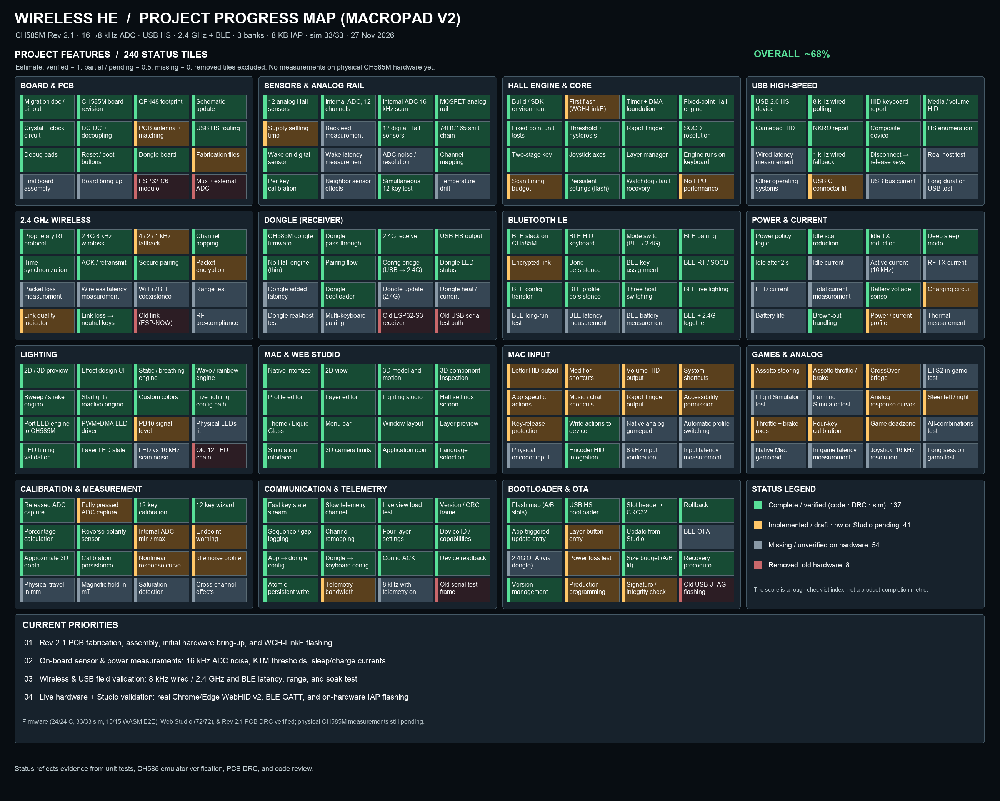
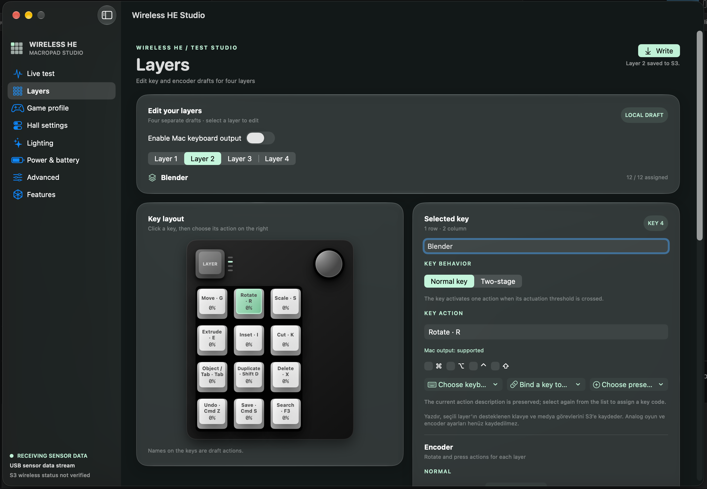
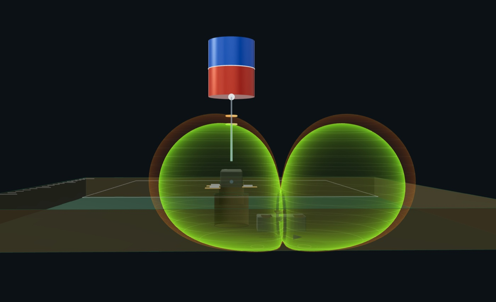
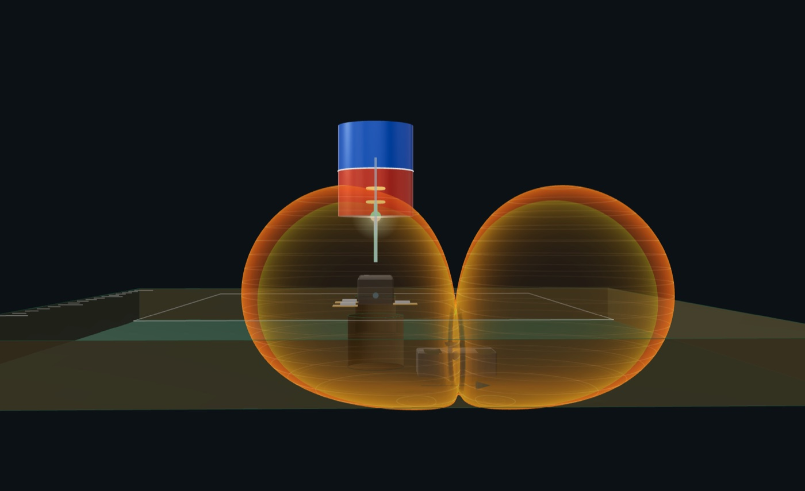

# Wireless HE Macropad

A wireless 12-key Hall-effect macropad with a custom PCB, its own firmware and a native macOS companion app. The goal is **analog key sensing without the battery drain**: the analog Hall sensors are powered down while idle and woken only when a key starts to move.

Active hardware and firmware prototype, not a finished product.

[](https://github.com/espressif/esp-idf)
[](#wireless-he-studio)
[](#v1--esp32-c6--esp32-s3-built)
[](LICENSE)

<table>
<tr>
<td align="center"><br><b>v1</b></td>
<td align="center"><br><b>v1 PCB</b></td>
</tr>
</table>

## The idea

Analog Hall sensors (DRV5055 here) draw current all the time. On a wireless board, 12 always-on sensors drain the battery even when nobody is typing. This project switches the analog sensor rail off while idle, wakes it when a key starts to move, then reads the real key depth for actuation, rapid trigger and analog features.

## Versions at a glance

| | **v1** (built) | **v2** (in development) |
|---|---|---|
| Keyboard MCU | ESP32-C6 (XIAO) | WCH CH585M |
| USB dongle | ESP32-S3 | WCH CH585M |
| Sensor chain | DRV5055 → CD74HC4067 mux → MCP3202 ADC | DRV5055 → MCU internal ADC |
| Scan rate | ~1 kHz (983 scans/s measured) | 16 kHz target |
| Report rate | ~1 kHz | 8 kHz target, wired and wireless |
| Wired USB | Through the S3 dongle | USB 2.0 High-Speed |
| Wireless | ESP-NOW to dongle + BLE HID | 2.4 GHz to dongle + BLE |
| Hall processing | On the dongle | On the keyboard (fixed-point) |
| Analog sensor power | MOSFET-switched rail | Switchable low-noise LDO + digital wake-up sensor per key |
| Status | Built and bench-tested | PCB routed, not manufactured; firmware tested in emulation |

v2 figures are design targets. v2 hardware files will be published after the first boards are tested.

## Progress: v1 vs v2

Each tile is a feature or check: verified = 1, partial = 0.5, missing = 0. The percentage is a rough checklist index.

| | **v1** (6 Nov 2026) | **v2** (27 Nov 2026) |
|---|---|---|
| Tiles | 224 | 240 (8 removed, not counted) |
| Verified / partial / missing | 133 / 48 / 43 | 137 / 41 / 54 |
| Estimate | ~70 % | ~68 % |
| Evidence | Tests on the built prototype | Unit tests, emulator, PCB DRC; **no v2 board yet** |

<table>
<tr>
<td align="center"><a href="Docs/progress/project-progress-en.png"></a><br><b>v1</b></td>
<td align="center"><a href="Docs/progress/project-progress-v2-en.png"></a><br><b>v2</b></td>
</tr>
</table>

---

## v1 — ESP32-C6 + ESP32-S3 (built)

- 12 analog Hall keys (3 × 4), a layer button, a rotary encoder and per-key RGB.
- Custom PCB: DRV5055 sensors, 16-channel multiplexer, external 12-bit ADC.
- **ESP32-C6 → ESP-NOW → ESP32-S3 → USB**, plus direct BLE HID from the C6.
- **Wireless HE Studio**, a native macOS app for calibration, layers, lighting and live telemetry.

<table>
<tr>
<td align="center"><br><b>Enclosure (render)</b></td>
<td align="center"><br><b>PCB</b></td>
</tr>
<tr>
<td align="center"><br><b>Studio · layers</b></td>
<td align="center"><br><b>Studio · lighting</b></td>
</tr>
</table>

### How it works

```text
12 × DRV5055 → CD74HC4067 mux → MCP3202 ADC
                                     │
                            ESP32-C6 macropad
                                     │ ESP-NOW
                                     ▼
Mac ← USB HID + serial telemetry ← ESP32-S3 dongle
 │                                   ▲
 └──── Studio configuration ─────────┘
```

### Tested on the prototype (5 Nov 2026)

| Area | Works | Still to do |
|---|---|---|
| Sensing | Calibration, channel mapping, live key depth | Long-run stability, cross-channel effects |
| Wireless | C6 → S3 → Mac telemetry with gap counters | Fewer active-mode gaps, latency and range, authenticated pairing |
| BLE | Typing on a Mac from a saved profile, mode switch with Layer + KEY 0 | Bond persistence across reboots, other hosts |
| USB keyboard | Per-layer actions, volume HID, layer kept across reconnect | NKRO (currently 6KRO) |
| Hall features | Rapid Trigger, SOCD last-pressed priority | Multi-key and long-duration tests, two-stage keys |
| Lighting | Live effects and layer sync | Storing settings on the device |
| Power | Idle scan policy, MOSFET duty cycling | Real current and battery-life measurement |

### Wireless HE Studio

Native **SwiftUI / AppKit / SceneKit** app:

- Live ADC graph, channel diagnostics, remapping, per-key calibration
- 2D/3D views with an exploded component view
- Four layers, Rapid Trigger, SOCD, local profiles, 13 starter profiles
- Lighting effects: static, breathing, wave, sweep, reactive, ripple, starlight, rainbow, snake
- Turkish and English

### Sampling and power experiments

Idle scan is **100 Hz**, active target **1 kHz**. One active test measured **983 scans/s** and **858 radio submissions/s**. With the MOSFET build, the sensor rail was on about **13 %** of the time while idle (commanded, not measured). Duty cycling while active dropped the scan rate to ~620/s, so the rail stays on while keys are in use. Power savings have not been measured yet.

### Hardware

| Component | Role |
|---|---|
| 12 × DRV5055A4 | Analog Hall sensors |
| CD74HC4067 + MCP3202 | Multiplexer + 12-bit ADC |
| XIAO ESP32-C6 | Keyboard |
| ESP32-S3 | USB dongle |
| 12 × SK6812MINI | Per-key RGB |

Pinout: see the [bridge README](examples/c6_s3_sensor_bridge/README.md).

### Repository layout

| Path | Contents |
|---|---|
| [`Hardware/Kicad/`](Hardware/Kicad/) | PCB and schematic |
| [`Firmware/macropad-sender/`](Firmware/macropad-sender/) | C6 firmware |
| [`Firmware/dongle-receiver/`](Firmware/dongle-receiver/) | S3 firmware |
| [`Firmware/shared/`](Firmware/shared/) | Shared modules and tests |
| [`examples/c6_s3_sensor_bridge/`](examples/c6_s3_sensor_bridge/) | Current C6/S3 prototype |
| [`examples/c6_ble_hid_lab/`](examples/c6_ble_hid_lab/) | BLE HID experiment |
| [`examples/macropad_12_idf/mac_app/`](examples/macropad_12_idf/mac_app/) | Studio macOS app |
| [`examples/lighting_espnow_lab/`](examples/lighting_espnow_lab/) | Lighting experiments |
| [`examples/crossover_analog/`](examples/crossover_analog/) | Analog controller experiment |
| [`tools/`](tools/) | Progress map generators |

### Build

ESP-IDF 6.1:

```sh
cd examples/c6_s3_sensor_bridge/c6
idf.py -B build-ble -D SDKCONFIG=sdkconfig.ble build
```

```sh
cd examples/c6_s3_sensor_bridge/s3_composite
idf.py set-target esp32s3
idf.py build
```

Studio: see the [Studio README](examples/macropad_12_idf/mac_app/README.md) (macOS 26, not notarized). Releases: [changelog](releases/CHANGELOG.md).

### Known limitations

- ESP-NOW frames are not authenticated; BLE uses Just Works pairing (no MITM protection).
- No NKRO, analog gamepad output or encoder HID yet.

---

## v2 — CH585M (in development)

Both the keyboard and the dongle move to the **WCH CH585M** (RISC-V, USB 2.0 HS, BLE 5.4, 2.4 GHz radio) for high polling rates wired and wireless.

- **Simpler sensor path:** sensors go straight into the MCU's ADC; no mux, no external ADC.
- **Hall engine on the keyboard** in fixed-point; the dongle only forwards reports.
- **Switchable analog supply** with a low-power digital wake-up sensor per key (see [below](#choosing-the-wake-up-sensor)).
- **Separate telemetry stream** for Studio, so the live view does not cost report rate.
- **Power:** BQ25300 charger, 18650 cell, low-Iq 3.3 V regulator.

| Area | State |
|---|---|
| Schematic, PCB | 4-layer layout done, DRC clean, not ordered |
| Firmware | Keyboard, dongle and 8 KB USB bootloader written: Hall engine, USB HS, 2.4 GHz, BLE, lighting, sleep, battery policy. Tested on a CH585 emulator; **not run on hardware** |
| Studio | Also runs in Chrome/Edge (WebHID, Web Bluetooth) with firmware update |
| Enclosure | 3D-printable case and aluminium plate drawn |
| Wake-up sensor | One KTM1301TA per key on the PCB; a four-key test board is ready for fabrication |
| Measurements | Planned: idle current, scan rate, latency |

### Choosing the wake-up sensor

A low-power digital sensor must detect that a key has *started* to move and turn off again when it is released. Our first candidate, a digital Hall switch next to the key, turned on before the key was pressed and stayed latched afterwards. So we measured the magnet.

**Measurements** (22 Nov 2026, v1 board): rest and full-press field on all 12 keys via the DRV5055s, the bare magnet (Ø2.80 × 3.37 mm) at 1.45–11.9 mm distance and 0–7.5 mm sideways, switch travel 3.93 mm.

**Model:** 75 points fitted with a finite-cylinder magnet model (remanence 1289 ± 70 mT, χ²/dof = 2.08). It predicts 14.0 mT at the centre sensor at rest; the 12 keys measure 13.84 ± 1.14 mT.

**Result**

- **Top side, next to the key:** 3–6 mT at rest, above the release threshold, so the sensor never turns off.
- **Bottom side, 3.0 mm from the key centre:** 2.21 mT at rest, 13.5 mT fully pressed.
- **Part:** Sensitec **KTM1301TA** (TMR, omnipolar, 4.5 / 3.6 mT typical, 1.9 µA).
- **Predicted:** trigger at **1.66 mm**, release at 1.16 mm. Worst case (5.0 mT threshold, 5.4 % weaker magnet) triggers at 2.02 mm.
- Raising the switch by 1 mm delays the trigger by 1 mm.

<table>
<tr>
<td align="center"><br><b>At rest:</b> magnet outside the trigger region</td>
<td align="center"><br><b>Pressed 2.2 mm:</b> on until it leaves the release region (orange)</td>
</tr>
</table>

Not yet tested with real KTM1301 parts; the test board is for that.

## License

[GPL-3.0-only](LICENSE). Third-party components keep their own licenses.
